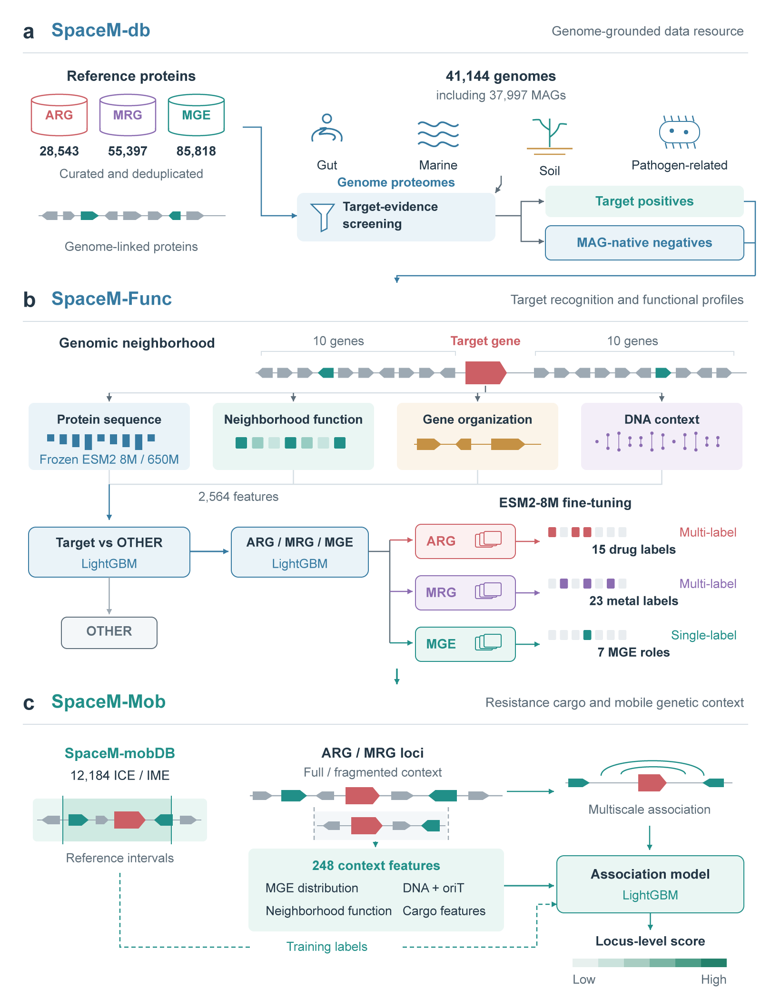

# SpaceM

**Genome-centric identification of resistance functions and mobile genetic contexts.**

SpaceM links target recognition, functional profiles and locus-level mobile-element association in one workflow. It integrates frozen protein-language-model representations with gene organization, neighborhood function and DNA context, followed by task-specific ESM2-8M fine-tuning.



[完整中文算法流程](ALGORITHM_ZH.md) · [Software](SOFTWARE.md) · [Databases](DATABASES.md) · [Inputs and outputs](INPUTS_OUTPUTS.md) · [Model assets](MODEL_ASSETS.md)

## Download the complete source and example

[Download SpaceM source and examples (ZIP)](SpaceM_source_examples_20261108.zip). The archive preserves all 150 files and their directory structure, including source code, prepared inputs and the interactive HTML report. Extract it and work inside the `SpaceM/` folder. Documentation and Fig. 1 are also available separately in this repository.

## Workflow

1. **Prepare genome-linked proteins.** Match protein sequences, contig coordinates, frozen ESM2-8M/650M embeddings, Pfam/eggNOG annotations and DNA-context features. The center gene and ten CDS on either side define the W10 neighborhood.
2. **Recognize targets.** Five V3HN LightGBM models distinguish target proteins from OTHER using 2,564 features and a fixed threshold of 0.737447579539902.
3. **Assign the target class.** Five conditional V2 LightGBM models distinguish ARG, MRG and MGE using their own saved fold vocabularies.
4. **Resolve functions.** Three ESM2-8M fine-tuned branches predict 15 ARG drug labels, 23 MRG metal labels or seven MGE functions. ARG/MRG are multilabel; MGE is single-label. Each task uses 15 models.
5. **Score mobile genetic association.** UNIFIED248 combines spatial MGE evidence, neighborhood/DNA context, oriT and cargo information at ARG/MRG loci. Its fixed threshold is 0.1396680282651571. The score measures ICE/IME-reference association, not observed transfer probability.
6. **Attach reference evidence.** Predicted ARG/MRG/MGE proteins are aligned to the three positive FAA libraries. Identity, both coverages, source labels and cross-class disagreements are reported separately from model output. OTHER alignments are not displayed.
7. **Inspect and export.** A self-contained HTML report provides searchable predictions, functional probabilities, full-context mobility scores, genomic neighborhoods and downloadable tables.

## Example report

Download and extract [the source archive](SpaceM_source_examples_20261108.zip), then open `SpaceM/results/demo/report.html` in a browser. No server or internet connection is required. GitHub's source-file view does not execute the interactive HTML.

The example includes 10 proteins: two predicted ARG, two MRG, four MGE and two OTHER; reference alignments are shown for the eight predicted targets. Four resistance loci have full-context mobility scores. These previously analyzed development examples demonstrate software execution and are not independent accuracy estimates.

## Run

After extracting the source archive, run the commands below from its `SpaceM/` directory. This release starts from **prepared sequence/context features**. It is not a raw-FASTA-only annotation command. Full trained checkpoints and external reference databases must be provisioned separately; see [asset availability](MODEL_ASSETS.md). The source-only runtime in this repository does not contain those weights.

```bash
export PYTHONNOUSERSITE=1
export HF_HUB_OFFLINE=1
export TRANSFORMERS_OFFLINE=1
export SPACEM_RUNTIME=/absolute/path/to/complete/runtime
export SPACEM_FINE_PYTHON=/absolute/path/to/fine-environment/bin/python
export SPACEM_DIAMOND=/absolute/path/to/diamond

/absolute/path/to/score-environment/bin/python scripts/workflow.py \
  --inputs examples/botelho/inputs.json \
  --out results/new_run --threads 4
```

Configure `examples/botelho/references.json` with the FAA and metadata paths. Use a new output directory. Two verified inference environments and the extra tools for raw annotation are documented in [SOFTWARE.md](SOFTWARE.md).

## Layout inside the source archive

```text
scripts/                  linked inference, alignment and report entry points
algorithms/runtime/       source-only frozen runtime and feature contracts
algorithms/research/      stage-specific research/training source snapshots
examples/botelho/         small prepared-feature demonstration inputs
results/demo/             computed example report and results
figures/                  latest Fig. 1: PNG, PDF, SVG and Illustrator source
docs/                     algorithm, data, software, input/output and asset guides
```

## Interpretation

Reference evidence, model functional calls and mobile-element association describe different levels of evidence. Reference intervals are not prediction features. Unknown or OTHER proteins are not experimentally verified negatives, and a high mobility score does not establish active transfer. The report displays full contexts only and does not include simulated-fragment comparison panels.

## Figure and resource provenance

Fig. 1 is the architecture revision dated **2026-11-08**. It summarizes SpaceM-db, SpaceM-Func and SpaceM-Mob. The positive protein libraries contain 28,543 ARG, 55,397 MRG and 85,818 MGE representatives; these are not interchangeable with fine-task training counts or genome-expanded candidates. See [database provenance](DATABASES.md), including the distinction between inherited CARD evidence and a separately inventoried CARD FASTA.

Third-party resources retain their respective licenses. No license is implicitly granted for external databases or pretrained models by this repository.
