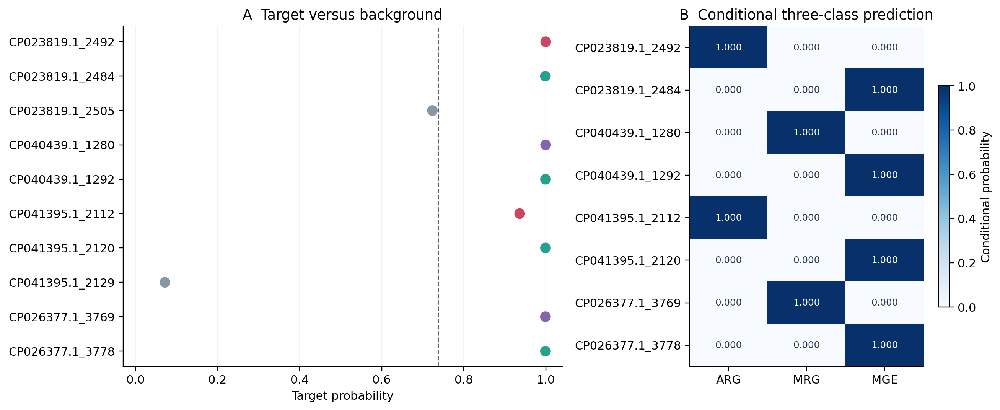
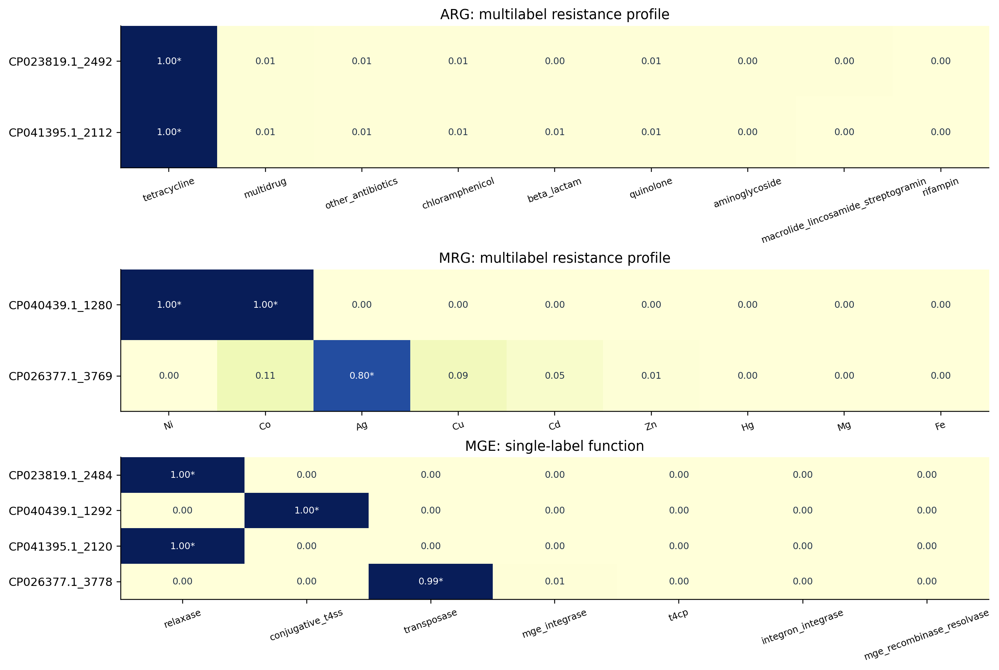
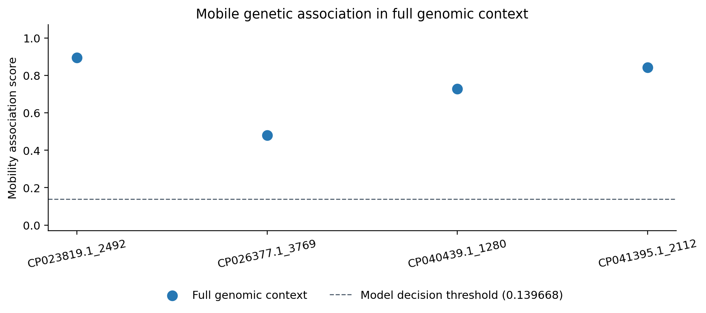
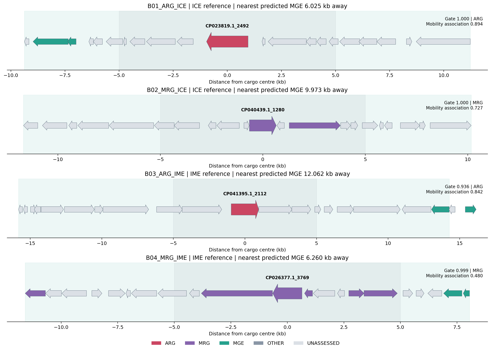

# SpaceM (Space-MAG)

**A genome-centric workflow linking resistance functions to mobile genetic contexts.**

SpaceM identifies ARG, MRG and MGE proteins, resolves their functional profiles, scores resistance loci for mobile-element association, and attaches sequence matches to curated positive references.


[Algorithm](docs/ALGORITHM.md) · [Installation](docs/INSTALLATION.md) · [Databases](docs/DATABASES.md) · [Inputs and outputs](docs/INPUTS_OUTPUTS.md) · [Models](docs/MODEL_ASSETS.md)

## 1. Download the workflow and example data

```bash
git clone https://github.com/alienn233/SpaceM.git
cd SpaceM
```

The repository includes the complete source tree, prepared Botelho example inputs and expected results. The same files are also available in [the source archive](SpaceM_source_examples_20261108.zip).

| Example input | Contents |
|---|---|
| `examples/botelho/proteins.faa` | Ten protein sequences |
| `examples/botelho/proteins.parquet` | Protein IDs, host/contig coordinates and strand |
| `esm8.npy`, `esm650.npy` | Frozen ESM2-8M/650M representations |
| `portable.npy`, `pfam.parquet`, `eggnog.parquet`, `mag.parquet` | Gene organization, neighborhood function and DNA features |
| `base229.parquet`, `local44.parquet` | Inputs for reconstructing the 248 mobility features |
| `BOTELHO_CASES.tsv`, `BOTELHO_CASE_GENES.tsv` | Reference cases and neighborhood coordinates |
| `inputs.json`, `references.json` | Relative-path input and reference configurations |

## 2. Install with Conda or Mamba

The environment files target Linux x86-64 CPU inference, matching B5. [Miniforge](https://github.com/conda-forge/miniforge) provides both Conda and Mamba. Full setup instructions are in [INSTALLATION.md](docs/INSTALLATION.md).

Using Conda:

```bash
conda env create -f envs/score.yml
conda env create -f envs/fine-cpu.yml
conda env create -f envs/tools.yml
```

Or using Mamba:

```bash
mamba env create -f envs/score.yml
mamba env create -f envs/fine-cpu.yml
mamba env create -f envs/tools.yml
```

| Environment | Components | Purpose |
|---|---|---|
| `spacem-score` | Python 3.14, NumPy, pandas, PyArrow, LightGBM, scikit-learn, SciPy | Feature assembly and hierarchy/mobility scoring |
| `spacem-fine` | Python 3.10, PyTorch 2.5.1 CPU, Transformers, Matplotlib | ESM2 fine inference and report generation |
| `spacem-tools` | DIAMOND 2.2.6 | Positive-reference alignment |

## 3. Install models and positive references

[Release v0.1.0](https://github.com/alienn233/SpaceM/releases/tag/v0.1.0) provides all trained models needed for the example, together with the positive FAA libraries and their annotation tables.

```bash
conda run -n spacem-score python scripts/download_assets.py
```

The installer verifies each archive and creates `assets/runtime/` and `assets/references/`. Mamba users can replace `conda run` with `mamba run`.

For an authenticated download with the GitHub CLI:

```bash
mamba install -n spacem-tools -c conda-forge gh
conda run -n spacem-tools gh auth login
conda run -n spacem-tools gh release download v0.1.0 --repo alienn233/SpaceM --dir assets/downloads
conda run -n spacem-score python scripts/download_assets.py --local-dir assets/downloads
```

| Asset | Contents |
|---|---|
| Core models | Five binary models, five conditional models, fold vocabularies, UNIFIED248 and the ESM2-8M backbone |
| ARG fine models | 15 checkpoints predicting 15 drug labels |
| MRG fine models | 15 checkpoints predicting 23 metal labels |
| MGE fine models | 15 checkpoints predicting seven functions |
| ARG references | 28,543 proteins and source/label metadata |
| MRG references | 55,397 proteins and source/label metadata |
| MGE references | 85,818 proteins and source/label metadata |

## 4. Run and validate the example

```bash
conda run -n spacem-score python scripts/run_demo.py --threads 4 --out results/my_demo
conda run -n spacem-score python scripts/validate_demo.py --inputs examples/botelho/inputs.json --out results/my_demo
```

Mamba equivalent:

```bash
mamba run -n spacem-score python scripts/run_demo.py --manager mamba --threads 4 --out results/my_demo
mamba run -n spacem-score python scripts/validate_demo.py --inputs examples/botelho/inputs.json --out results/my_demo
```

Open `results/my_demo/report.html` to explore predictions, functional probabilities, reference matches, mobility scores and genomic neighborhoods. The supplied result is available at `results/demo/report.html`. Each new run uses a new output directory.

The [Reproduce example workflow](.github/workflows/reproduce-example.yml) creates fresh environments, downloads the release assets, runs every prediction stage and validates the outputs. Fork the repository and select **Actions > Reproduce example > Run workflow** to execute it on GitHub. The resulting artifact contains the report, figures, prediction tables and validation record.

The workflow performs target recognition, conditional ARG/MRG/MGE assignment, task-specific fine inference, mobility scoring, positive-reference search and report generation. It averages five models at each hierarchy stage and 15 models per fine task. ARG/MRG support multiple functional labels; MGE receives one functional class. Alignment results are shown for predicted targets.

## 5. Expected results

The ten-protein example yields two ARG, two MRG, four MGE and two OTHER predictions. Eight predicted targets have 50 retained reference hits. Four resistance loci receive full-context mobility scores.

| Resistance locus | Class | Functional labels | Mobility association score |
|---|---|---|---:|
| `NZ_CP023819.1_2492` | ARG | tetracycline | 0.8937 |
| `NZ_CP040439.1_1280` | MRG | Co; Ni | 0.7275 |
| `NZ_CP041395.1_2112` | ARG | tetracycline | 0.8420 |
| `NZ_CP026377.1_3769` | MRG | Ag | 0.4799 |

These Botelho development cases illustrate predictions from the deployed models.

### Target recognition and class assignment



The target gate is followed by conditional ARG/MRG/MGE probabilities. The dashed line marks the target threshold.

### Functional profiles



Asterisks identify selected drug/metal labels or the selected MGE function. Complete probabilities are provided in the result tables.

### Mobility association



The four resistance loci are scored in their full genomic contexts. The dashed line marks the fixed threshold of 0.139668.

### Genomic neighborhoods



Targets are enlarged, with ten CDS shown on either side. Green shading marks reference ICE/IME intervals; colors identify predicted gene classes.

## Main outputs

| File | Result |
|---|---|
| `GENE_CLASSIFICATION.tsv` | Target probabilities, classes and functional labels |
| `03_fine/*_8M_FINE.tsv` | All functional probabilities and thresholds |
| `04_mobility/MOBILITY_UNIFIED248.tsv.gz` | Mobility association scores and calls |
| `05_alignment/PREDICTED_TARGET_REFERENCE_HITS.tsv` | Positive-reference alignments for predicted targets |
| `PREDICTIONS_WITH_REFERENCE.tsv` | Joined prediction and reference evidence |
| `report.html` | Interactive results |
| `RESULTS.txt` | Result descriptions and figure legends |
| `VALIDATION.json` | Reproduction checks |

## Apply to another dataset

Prepare protein sequences, consistent CDS coordinates and the sequence/context features listed in [INPUTS_OUTPUTS.md](docs/INPUTS_OUTPUTS.md). Copy `examples/botelho/inputs.json`, update the input paths, and run `scripts/workflow.py`. [INSTALLATION.md](docs/INSTALLATION.md) lists the Pfam, eggNOG, ESM-2 and oriT resources used to generate these features; [ALGORITHM.md](docs/ALGORITHM.md) describes their biological roles and the model stages.

Third-party resources retain their original licenses and citation requirements.
